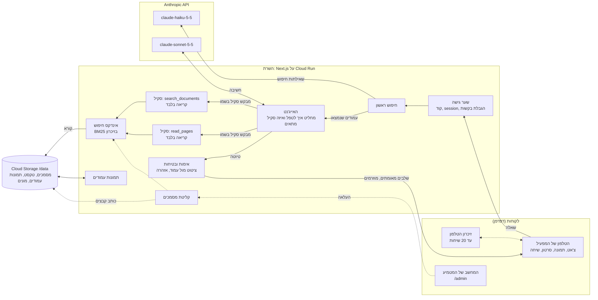
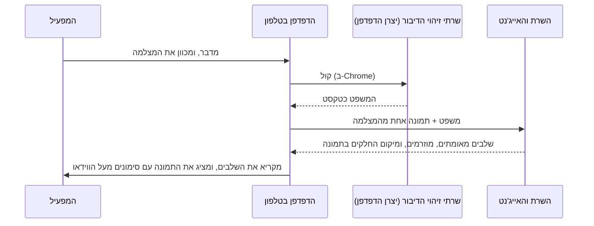

# ארכיטקטורה

מפה מעוצבת עם הסברים: https://claude.ai/artifact (ראו הקישור ב-README). כאן אותה מפה בקוד, כדי שתתעדכן יחד עם הריפו.

## שיחה חיה: קול ווידאו
השיחה החיה היא דרך נוספת להגיע לאותו אייג'נט (`app/components/Call.tsx`).

קיים: שיחה קולית, שיחת וידאו עם תמונה לכל משפט, סימון חלקים על התמונה שנשלחה, כפתור "צלמו ושלחו".
לא קיים: ניתוח רציף של הווידאו, סימון שעוקב אחרי החלק כשהמצלמה זזה, שיחת טלפון במספר טלפון, קול שאינו של הדפדפן.

## מי מחליט מה
| האייג'נט מחליט | הקוד מחליט |
|---|---|
| איך להבין את הפנייה, כולל התמונה | מי רשאי לשאול, וכמה |
| איזה סקיל מתאים, ואם צריך סקיל | אילו סקילים קיימים (כולם לקריאה בלבד) |
| לענות או לשאול את המפעיל | איזה שלב מוצג: רק מה שאומת מול המקור |
| ניסוח התשובה בעברית של יומיום | מתי מוצגת אזהרת בטיחות |
| איזה איור מהעמוד עוזר | מאיזה עמוד מותר להציג איור |

## איפה המידע נמצא
| מידע | איפה |
|---|---|
| מדריכים, טקסט לפי עמודים, תמונות עמודים, מוני שימוש | Cloud Storage (`DATA_DIR`). אין בסיס נתונים |
| שיחות המפעיל | בטלפון בלבד (`localStorage`) |
| אינדקס החיפוש, הגבלת בקשות | זיכרון השרת (מופע אחד) |
| מפתח המודל וסיסמאות | משתני סביבה |
